# InfraOrgIT Web

InfraOrgIT Web is the browser workspace for your IT infrastructure. Describe
providers, environments, servers, applications and projects once, then use the
same model to draw the topology, test APIs and reachability, open an SSH
console, transfer files and review what happened.

The screenshots use the fictitious "Acme" demo data, not a real installation.

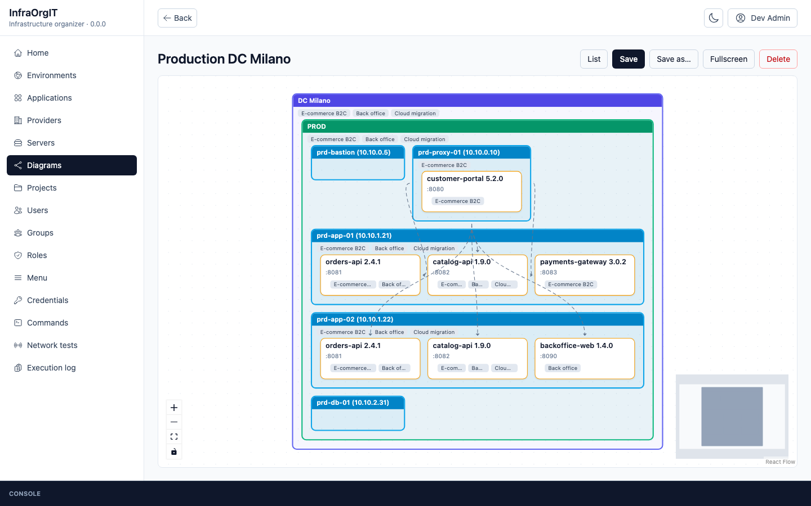

## What you can do

### Model the infrastructure

Keep providers, environments, servers, applications, versions, deployments and
projects in one place. A server carries its IP addresses, SSH port, hostname,
jump host, sizing, operating system and HA role; a deployment records how an
application version runs on that server.

| Servers | Application |
|---|---|
| 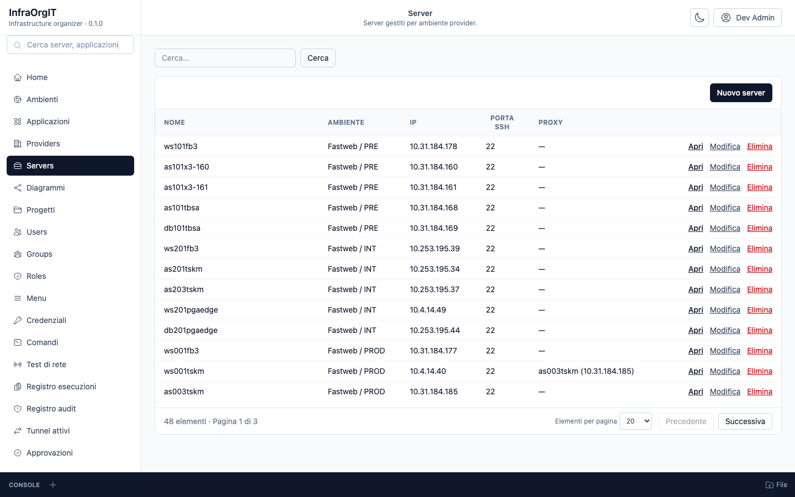 | 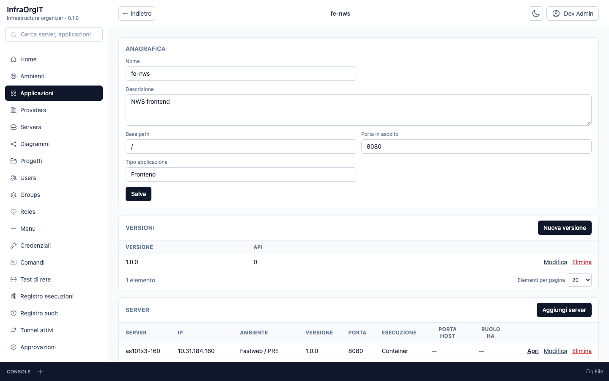 |
| **Server detail** | **Execution log** |
| 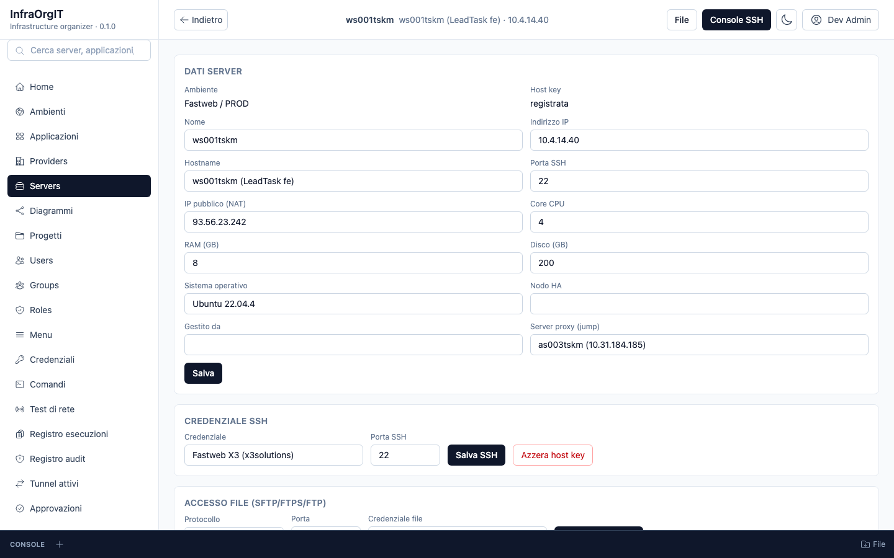 | 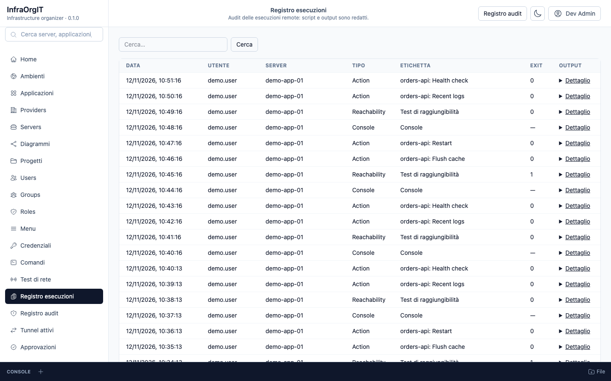 |

### Draw and explore the topology

The diagram is built from the same data: provider → environment → server →
deployed application, with proxy connections and routes. Filter by provider,
environment or project, arrange the layout and save it.

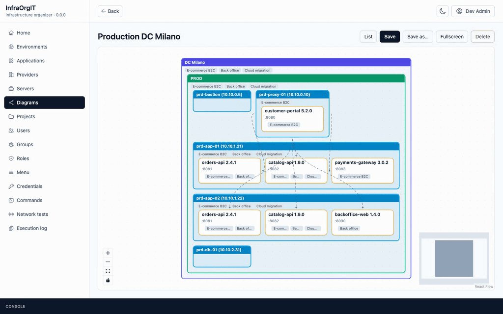

### Test APIs and network reachability

Import an OpenAPI 3.x or Swagger 2.0 document into an application version and
call its endpoints from the browser, with the environment hostname and API
keys. Host:port reachability tests run from the server itself over SSH, so the
result is what the server really reaches.

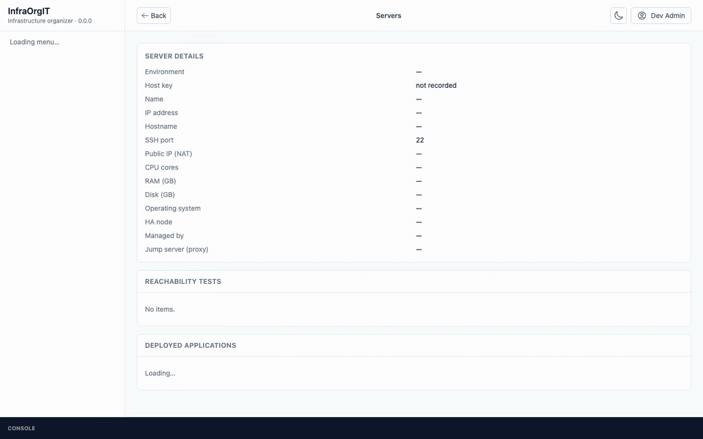

### Work on servers

Open an SSH console with several sessions side by side or minimized to the bar
at the bottom. The same bar opens an SFTP/FTPS file browser. If the server has
no file protocol or no usable credential, the browser shows a warning and lets
a SystemAdmin configure protocol, port and credential inline (or open the
Credentials page) before retrying. Command templates and application actions
(restart, logs, health check) run from the server page; every session, action
and test is written to the audit log.

### Approve AI actions

MCP clients can read the inventory and request actions. An action requested by
an AI client does not run on its own: it becomes a **Pending** request on
`/approvals`. You check server, application and action, then approve or deny
from your browser session. The request expires after 10 minutes, is used once
and cannot be approved by the AI client itself.

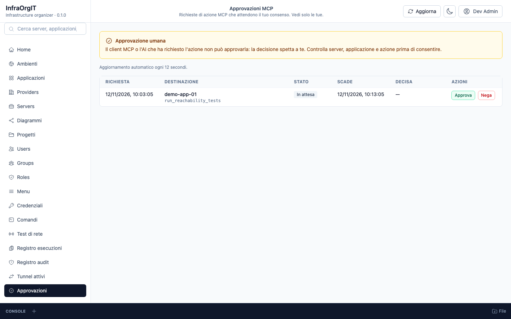

### See desktop tunnels

Tunnels opened by InfraOrgIT Desktop are projected on `/tunnels`: local port,
target, server, user and last contact. The page refreshes every 15 seconds, so
the team can see which forwards are active. The desktop reuses the instance
BFF session, so a user already signed in to the Web app does not need a second
tunnel login.

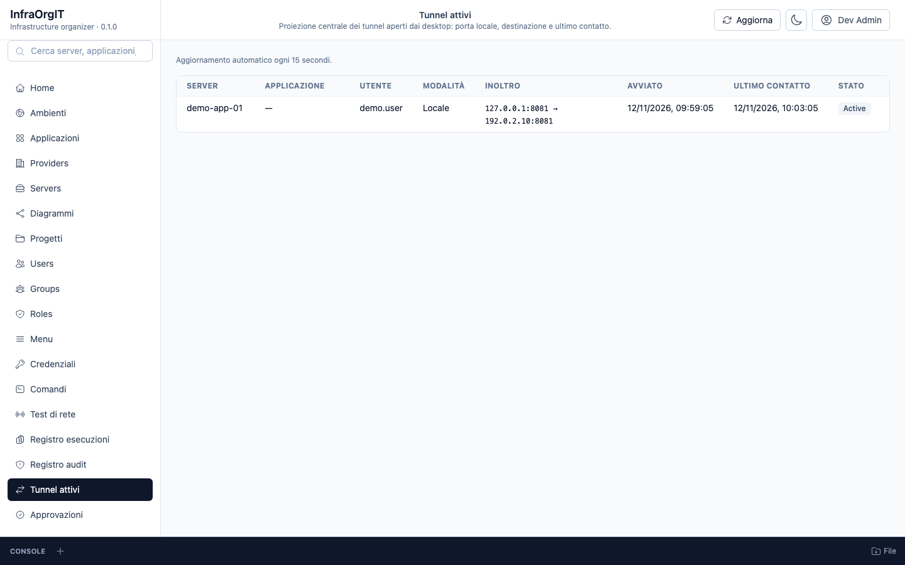

When nothing is running, the page explains that tunnels are opened from the
desktop app or from the server's Tunnel section; the browser page is only the
active-session view.

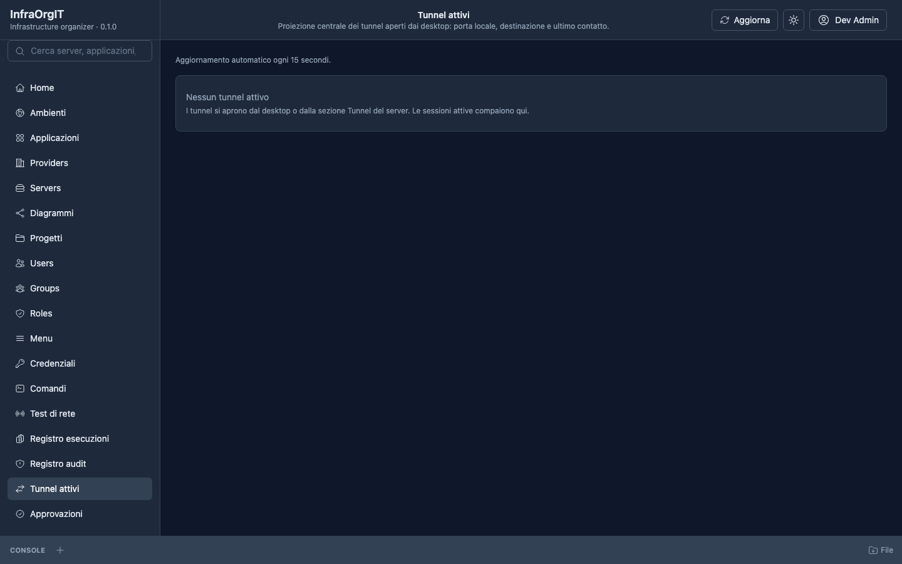

### Keep an audit trail

`/audit` records MCP tool calls and tunnel events with actor, client, target,
outcome, error code and correlation id. Administrators can filter by type,
outcome and server.

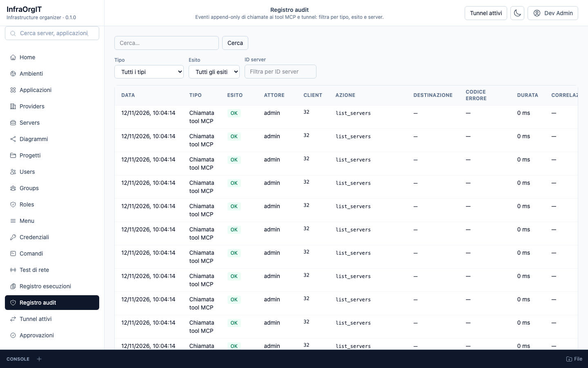

### Control access

Keycloak handles login through the backend-for-frontend: the browser never sees
an access token. Users, groups and roles are managed in the app. `SystemAdmin`
owns the master data; `ServerAdmin` and `ServerOperator` are granted per
environment and control what a user can open or run. The sidebar is filtered
by role, so each user sees only the pages they can use.

Personal API tokens for MCP clients and automations are created from the user
menu. The raw value is shown once; grant only the scopes the client needs.

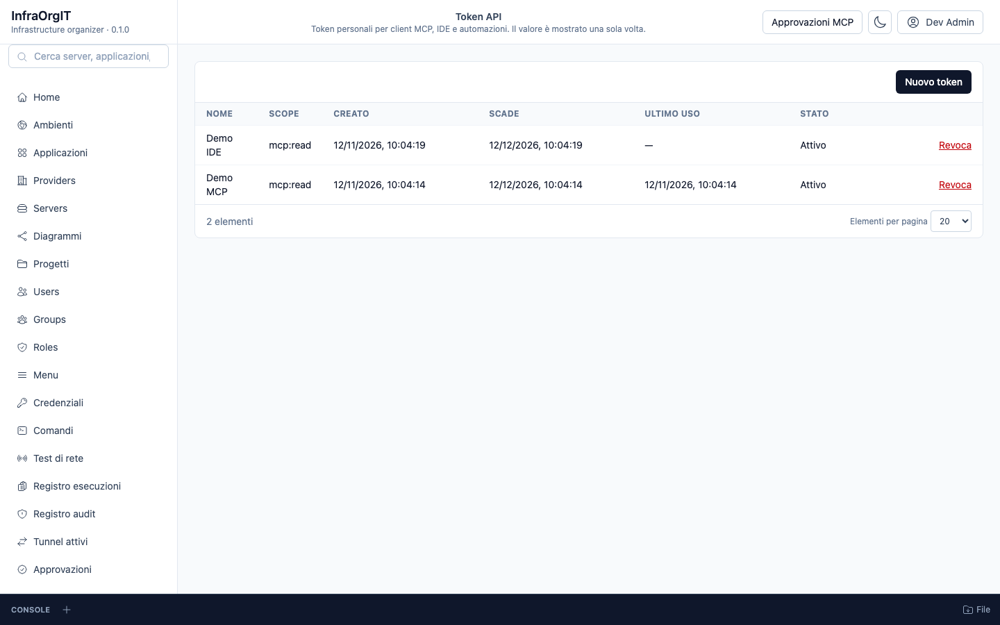

## Downloads in the desktop app

When InfraOrgIT runs inside InfraOrgIT Desktop, file downloads can use two
routes:

- **Bridge**: the app asks the server for a short-lived one-time link and saves
  the file in the desktop process. The download runs in the background, so a
  slow server does not block the window.
- **Native**: the desktop webview saves the file directly: Windows WebView2,
  or macOS with the optional patched Photino build. It requires the platform
  support and is not used for generated blobs.

The desktop manager chooses `Automatico`, `Bridge` or `Nativo`. The server
administrator can disable the signed bridge with
`DESKTOP_DOWNLOADS_ENABLED=false`; the desktop then uses its native route.
Generated API results keep using the bridge because WKWebView does not reliably
save blob URLs.

## Sign in

Open the URL of your InfraOrgIT instance and sign in with the Keycloak account
provided by your administrator. If the deployment enables MFA, Keycloak asks
for the second factor before the app loads.

Use the user menu to switch between Italian and English or to cycle the light,
dark and system theme (the system option keeps the operating-system
appearance). The menu labels stored in the database can be edited by an
administrator from **Menu**.

## Learn more

- [AllInfraOrgIT](https://github.com/SenseiKiritof/AllInfraOrgIT) — product
  overview, deployment and architecture.
- [`../AllInfraOrgIT/docs/ux/pages.md`](../AllInfraOrgIT/docs/ux/pages.md) —
  page map and flows.
- [`../AllInfraOrgIT/docs/security/permissions.md`](../AllInfraOrgIT/docs/security/permissions.md)
  — role matrix.
- [`docs/DEVELOPMENT.md`](docs/DEVELOPMENT.md) — local development, tests, UI
  conventions and image build.
