# InfraOrgIT Web

InfraOrgIT Web is the browser workspace for your IT infrastructure. Describe
providers, environments, servers, applications and projects once, then use the
same model to draw the topology, test APIs and reachability, open an SSH
console, transfer files and review what happened.

The screenshots use the fictitious "Acme" demo data, not a real installation.

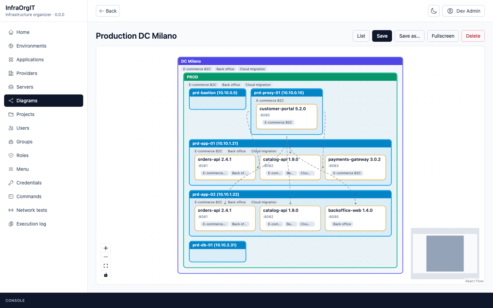

## What you can do

### Model the infrastructure

Keep providers, environments, servers, applications, versions, deployments and
projects in one place. A server carries its IP addresses, SSH port, hostname,
jump host, sizing, operating system and HA role; a deployment records how an
application version runs on that server.

| Servers | Application |
|---|---|
| 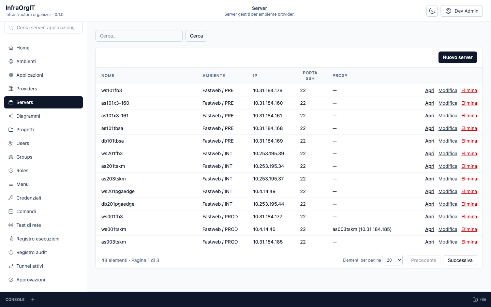 | 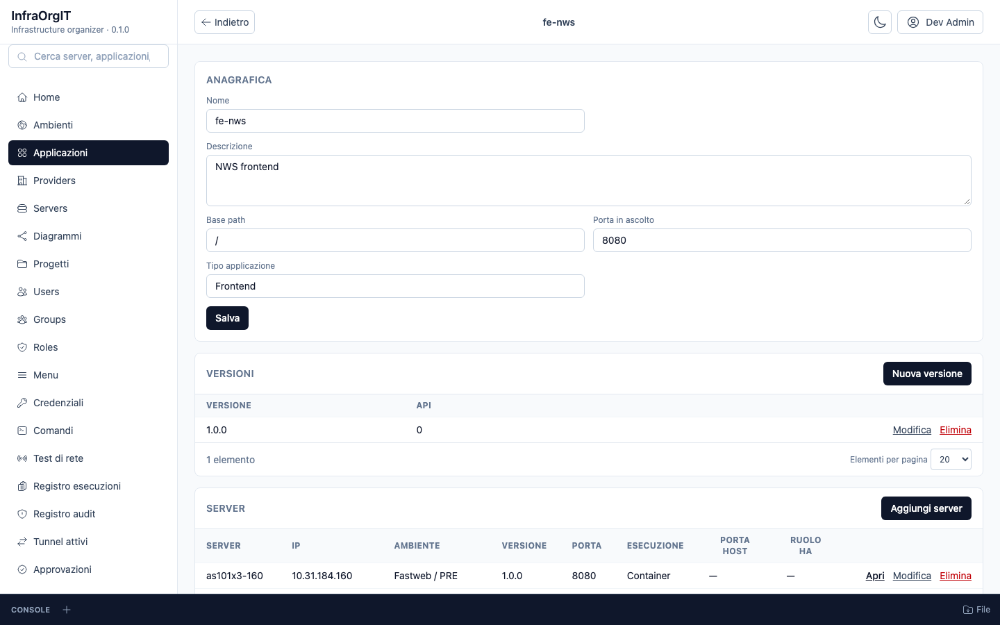 |
| **Server detail** | **Execution log** |
| 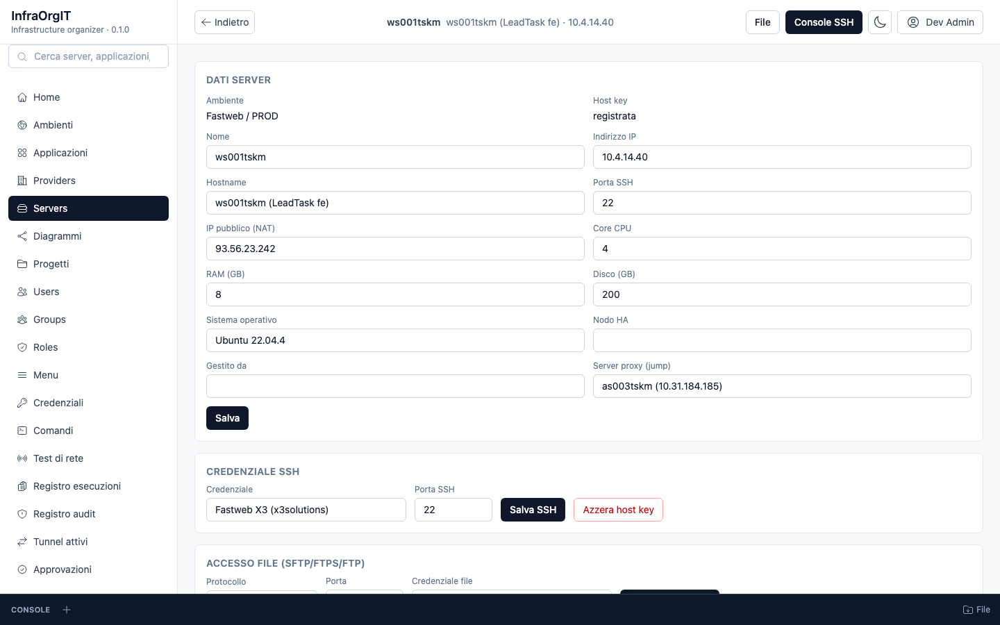 | 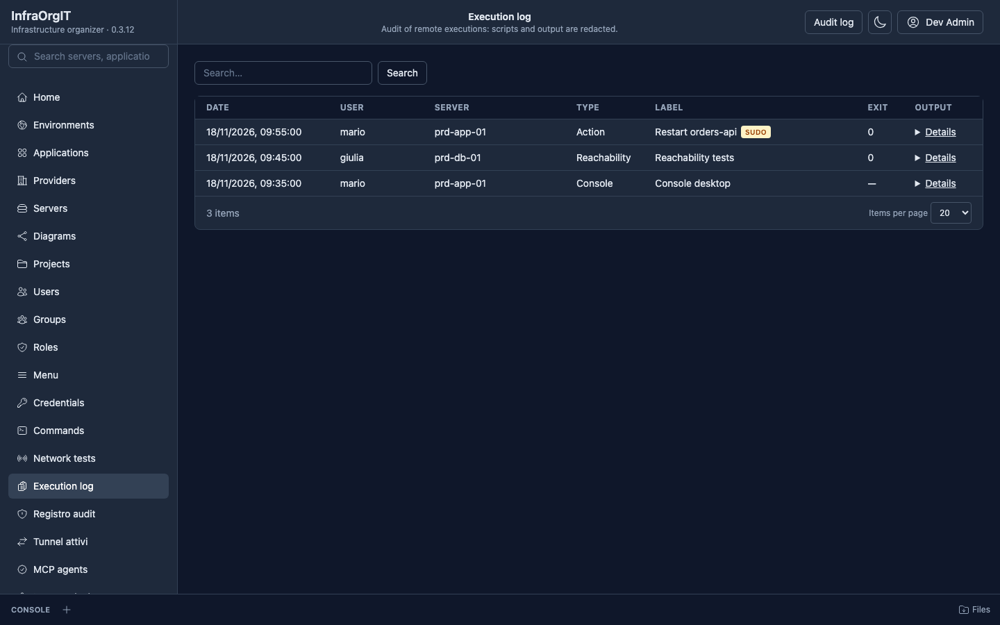 |

### Draw and explore the topology

The diagram is built from the same data: provider → environment → server →
deployed application, with proxy connections and routes. Filter by provider,
environment or project, arrange the layout and save it.

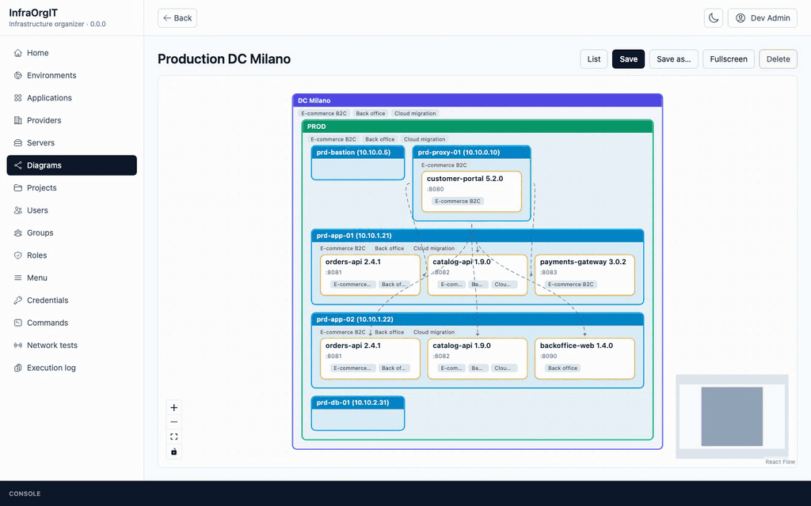

### Test APIs and network reachability

Import an OpenAPI 3.x or Swagger 2.0 document into an application version and
call its endpoints from the browser, with the environment hostname and API
keys. Host:port reachability tests run from the server itself over SSH, so the
result is what the server really reaches.

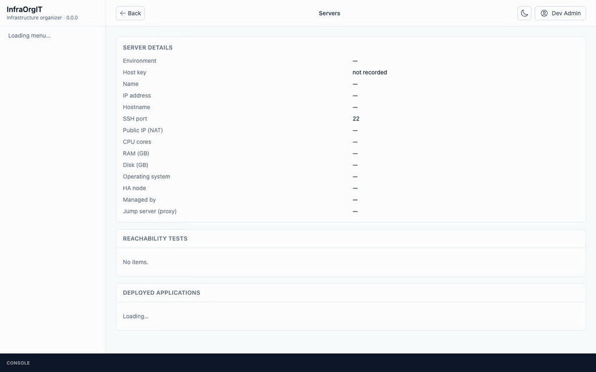

### Work on servers

Open an SSH console with several sessions side by side or minimized to the bar
at the bottom; the same server can have more than one console. The same bar
opens an SFTP/FTPS browser in the same 1/2/3 panes, so a console and a file
browser can stay side by side, and one height handle resizes both. The file
browser offers breadcrumb navigation, hidden-file toggle, sorting, filtering,
multi-select bulk delete, drag-and-drop upload and download; refresh keeps the
current rows visible while the new listing loads, and both console and SFTP tabs
come back after a page refresh. Downloads and uploads show the transferred bytes
and percentage. If the server has no file
protocol or no usable credential, the browser shows a warning and lets a
SystemAdmin configure protocol, port and credential inline (or open the
Credentials page) before retrying. Command templates and application actions
(restart, logs, health check) run from the server page; every session, action
and test is written to the audit log.

### Check OS lifecycle

Every hour InfraOrgIT reads the OS release of each server with an SSH
credential and stores the latest result: current version, available major
upgrade, EOL date and status. Ubuntu, Debian, RHEL/Alma/Rocky/Oracle and SLES
are recognised; endoflife.date fills the upgrade and EOL data when the server
tool is missing. The server list marks an EOL in orange within 60 days and in
red after expiry. **Impostazioni → Aggiornamenti sistema operativo** enables
the check and the LTS default; each server can inherit, force LTS or allow
non-LTS (RHEL, SLES and Debian are always LTS). **Controlla ora** in the server
detail starts the same check in the background and refreshes the result. The
check is read-only and never modifies the server.

### Query databases

Database applications (MySQL/MariaDB, PostgreSQL, MongoDB, Redis, SQL Server,
Oracle) show **Query DB** on every deployment. The query runs on the server
through SSH with its local client, without storing database passwords in
InfraOrgIT: MySQL, PostgreSQL and Oracle execute inside a read-only
transaction; MongoDB, Redis and SQL Server require a read-only login on the
server. There is no query allowlist: joins, CTEs, aggregation pipelines and
read commands are allowed, while transaction control and write/escape
statements are blocked. The 20-second result is shown in the browser and
recorded in the execution log.

### Approve AI actions

MCP clients can read the inventory and request actions. The first action call
creates a **Pending** MCP agent on `/approvals`; there is no per-call approval
row. You approve the agent once with individual permissions
(`reachability.run`, `actions.run`, per environment or all), then edit or revoke
them at any time. Denying or revoking an agent also revokes the personal API
token that created it; action calls still need the environment operator right
and `confirm=true`.

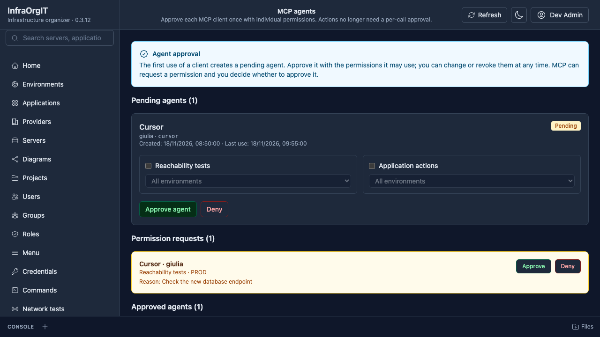

### Manage credentials and devices

`/credentials` (SystemAdmin) marks a credential as shared or owned by a user,
enables offline use per credential, shows the servers that use it and lists the
desktop devices enrolled by users. A shared credential is downloadable only by
operators of an environment where it is assigned; a personal credential only by
its owner and cannot be assigned to servers or file transfer. The desktop gets
secrets encrypted for its own RSA device key, so the browser never receives
them. Revoking a device drops its cached copies, and a credential version change
invalidates the cached copy on the next access.

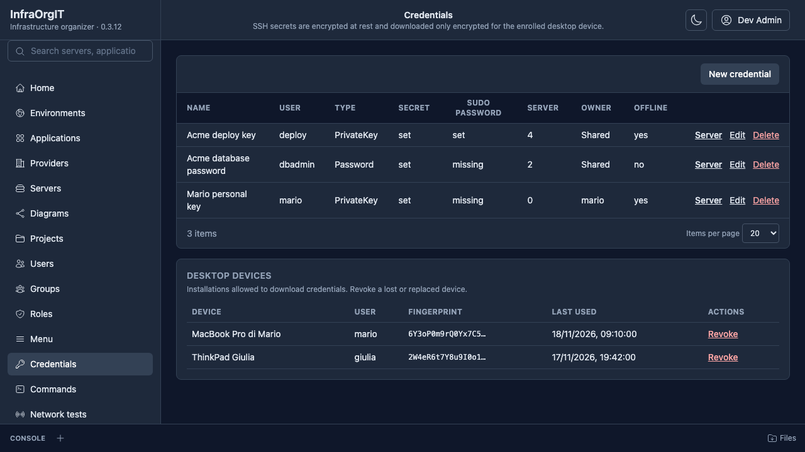

### See desktop tunnels

Tunnels opened by InfraOrgIT Desktop are projected on `/tunnels`: local port,
target, server, user and last contact. The page refreshes every 15 seconds, so
the team can see which forwards are active. The desktop reuses the instance
BFF session, so a user already signed in to the Web app does not need a second
tunnel login.

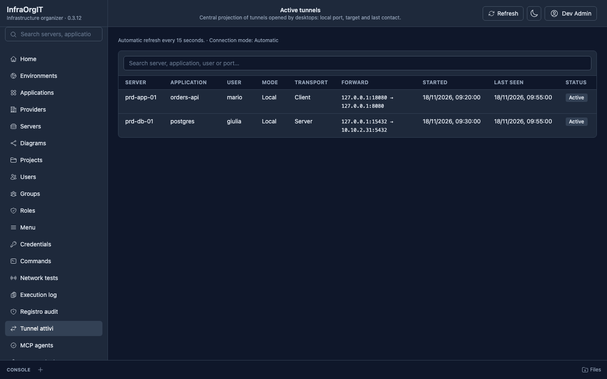

When nothing is running, the page explains that tunnels are opened from the
desktop app or from the server's Tunnel section; the browser page is only the
active-session view.

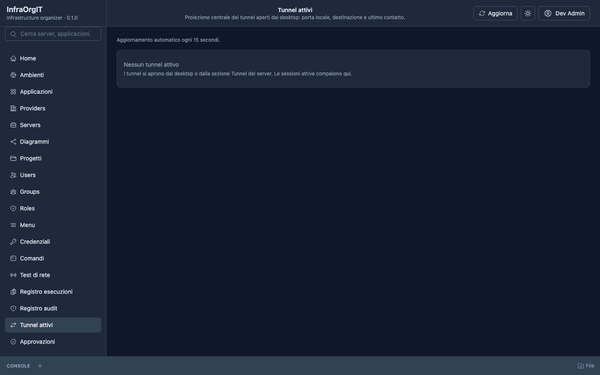

The desktop also keeps an encrypted inventory snapshot for offline use, runs
local TCP/TLS/HTTP checks from the machine or through the first jump host, and
queues check results and tunnel events for the central audit until the instance
is reachable again.

### Choose the connection mode

`/settings` (SystemAdmin) chooses how the installation opens tunnels. The
default is **Auto**.

| Mode | Behaviour |
|---|---|
| **Auto** (default) | Tunnels, console, files and actions use the desktop when the client reaches the first SSH hop and has a key-based SSH agent or a downloaded credential; otherwise they use the server. A password credential without a downloaded copy uses the server. |
| **Server** | Tunnels go through the API; console, files and actions run on the server. Only `Local` services and deployments with a fixed target port are relayed. |
| **Client** | Tunnels, console, files and actions use the desktop SSH agent or a downloaded credential; `Local`, `Dynamic` and `Remote` tunnels are available, but `Dynamic` and `Remote` always require an agent key. |

The value is stored in the shared `ConnectionPolicies` row, so every API node
in a cluster reports the same mode. Relay connections are node-local; the load
balancer needs WebSocket upgrades but no sticky sessions. The `/tunnels` page
shows the transport of each active session; direct console/actions and file
operations appear in the execution and audit logs.

### Export and import inventory

`/settings` (SystemAdmin) has **Data and backup**: export the inventory as a
versioned `.infraorgit.json` file, or preview an import with counts, warnings
and credential references before confirming. Replace import is available only
on an empty local SQLite instance and keeps a pre-import backup.

### Keep an audit trail

`/audit` records MCP tool calls and tunnel events with actor, client, target,
outcome, error code and correlation id. Administrators can filter by type,
outcome and server.

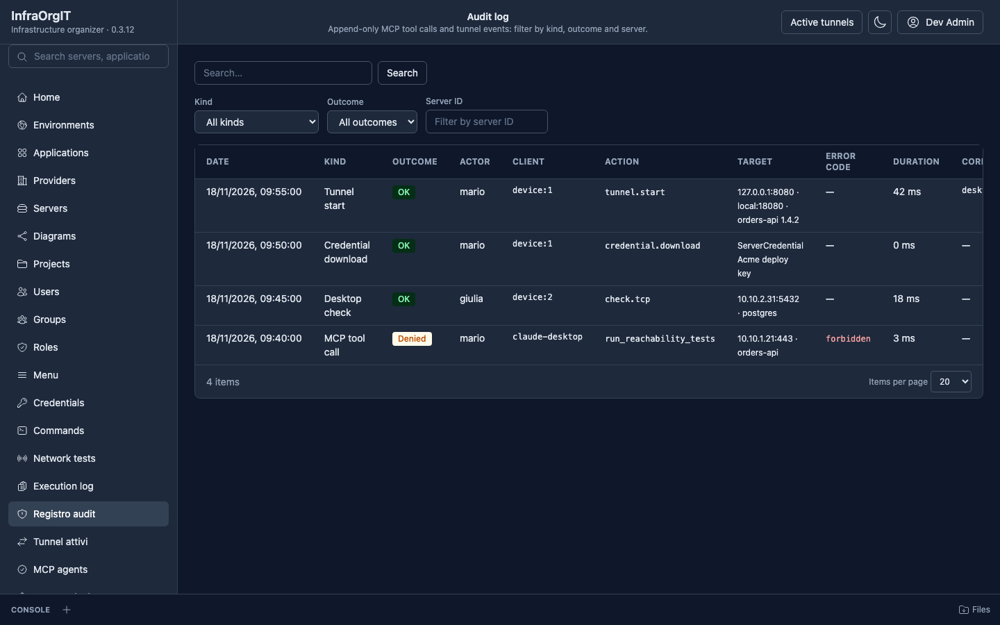

### Control access

Keycloak handles login through the backend-for-frontend: the browser never sees
an access token. Users, groups and roles are managed in the app. `SystemAdmin`
owns the master data; `ServerAdmin` and `ServerOperator` are granted per
environment and control what a user can open or run. The sidebar is filtered
by role, so each user sees only the pages they can use.

Personal API tokens for MCP clients and automations are created from the user
menu. The raw value is shown once; grant only the scopes the client needs.

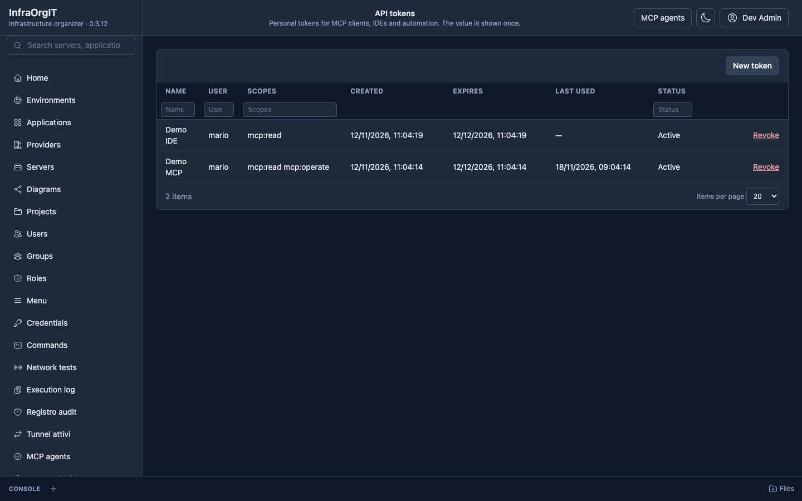

### Keyboard

Global search and the console server launcher support ArrowUp/ArrowDown,
Enter and Escape; the active row scrolls into view and stays visible in light
and dark themes. Forms that use the shared autocomplete have the same keyboard
behavior.

## Downloads in the desktop app

In the Electron desktop shell, server attachments use Chromium's native
download and generated API results use the desktop blob bridge, which opens a
native save dialog. There is no desktop download-mode setting in the UI.

The server-side `DESKTOP_DOWNLOADS_ENABLED` flag and the signed one-time
download tickets remain for API compatibility, but the Electron client does not
use those tickets.

## Sign in

Open the URL of your InfraOrgIT instance and sign in with the Keycloak account
provided by your administrator. If the deployment enables MFA, Keycloak asks
for the second factor before the app loads.

English is the default language. The user menu switches to Italian, French,
German or Spanish; keys without a translation fall back to English. The same
menu cycles the light, dark and system theme (the system option keeps the
operating-system appearance). The menu labels stored in the database can be
edited by an administrator from **Menu**; application names and descriptions
can carry a translation per language.

## Learn more

- [AllInfraOrgIT](https://github.com/SenseiKiritof/AllInfraOrgIT) — product
  overview, deployment and architecture.
- [`../AllInfraOrgIT/docs/ux/pages.md`](../AllInfraOrgIT/docs/ux/pages.md) —
  page map and flows.
- [`../AllInfraOrgIT/docs/security/permissions.md`](../AllInfraOrgIT/docs/security/permissions.md)
  — role matrix.
- [`docs/DEVELOPMENT.md`](docs/DEVELOPMENT.md) — local development, tests, UI
  conventions and image build.
